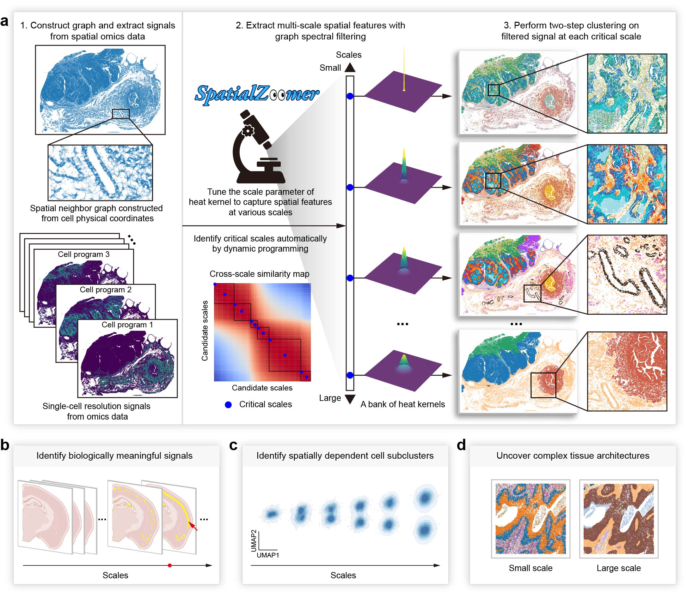
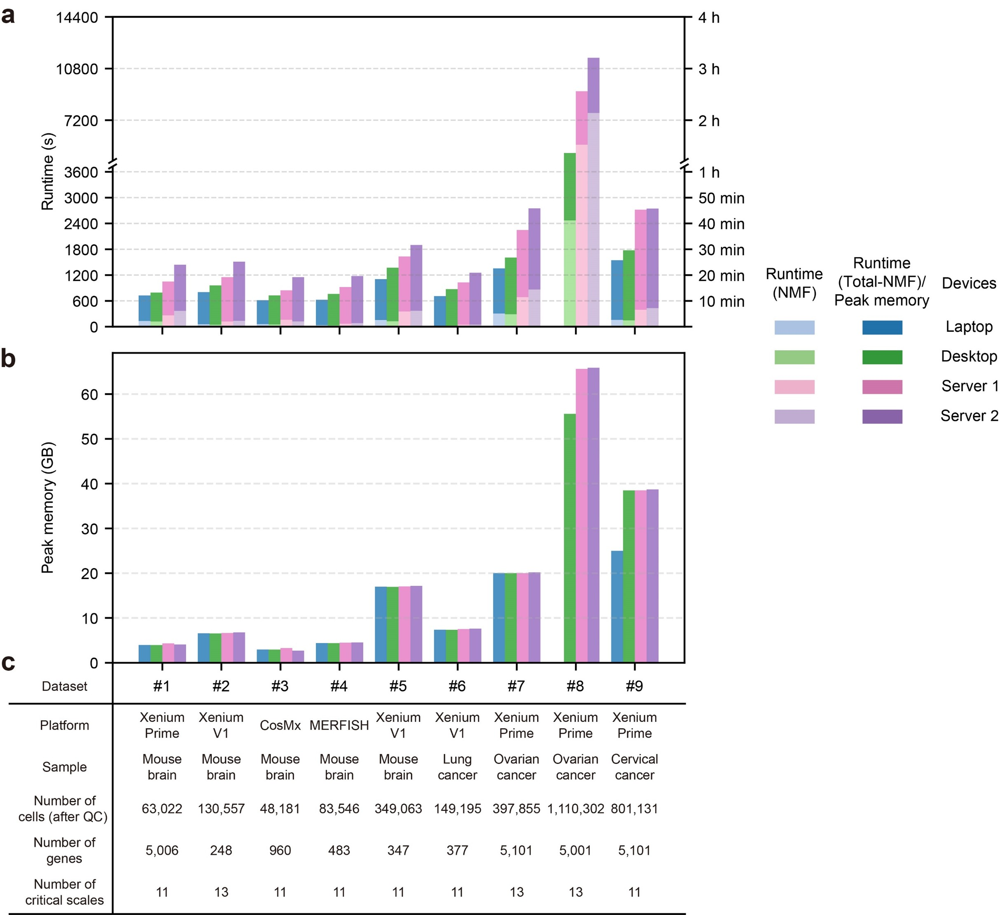
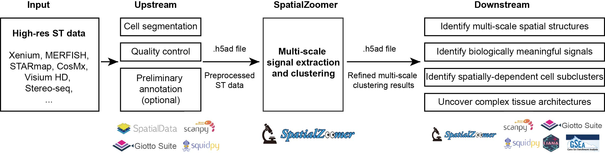

# SpatialZoomer: multi-scale feature analysis of spatial transcriptomics

The Python implementation of **SpatialZoomer**, a toolkit for **multi-scale spatial feature analysis** of single-cell resolved spatial transcriptomics via spectral graph signal processing. It scales to millions of cells with high computational efficiency and low hardware requirements.

Explore SpatialZoomer's multi-scale results by sliding the scale axis across four datasets on our interactive demo site:

👉 [**Demo Website**](https://li-xinqi.github.io/SpatialZoomer/)


## Contents

1. [Introduction](#introduction)
2. [System Requirements](#system-requirements)
3. [Cloning Tip](#cloning-tip)
4. [Installation](#installation)
5. [Tutorials](#tutorials)
6. [Result Reproduction](#result-reproduction)
7. [Cite](#cite)


## Introduction
SpatialZoomer is a novel computational method that enables the multi-scale feature analysis of single-cell resolved spatial transcriptomics like a zoom-capable microscope. By modeling gene expression as signals on spatial neighbor graph and applying spectral graph signal processing, the method efficiently extracts spatial features across multiple scales and reveals biologically meaningful structures. It can automatically identify “critical” scales by partitioning the cross-scale similarity map via dynamic programming. 

<p align="center">
  <br>
  <em>Schematic overview of SpatialZoomer</em>
</p>

### Functions

- **Zoom-capable analysis across spatial scales**  
   SpatialZoomer enables the detection of spatial structures from **cells**, **niches**, to **domains** across multiple scales. It can cpature biologically meaningful signals at specific scales, such as those related to disease progression in perturbation or longitudinal scenarios.

- **Identification of spatially dependent subtypes**  
   As the spatial scale increases, SpatialZoomer progressively integrates spatial context from larger neighborhoods into each cell’s transcriptomic profile, potentially enabling cells from a single cluster at scale 0 to separate into spatially dependent subclusters at larger scales. These spatial contexts can amplify transcriptomic heterogeneity between biologically distinct subtypes.

- **Uncovering complex tissue architecture**  
   The extracted multi-scale features can be used to dissect the complex spatial organization.

### Advantages
- High computational efficiency with relatively low memory requirements (No GPU required).
- Fast runtime, even for large-scale datasets.
- Scalable to >1 million cells on desktops.

## System Requirements
SpatialZoomer requires only a standard computer with sufficient RAM for in-memory operations and runs without the need for a GPU. It is lightweight and can be executed on **laptops, desktops, or servers**.

### Tested Devices:

| Device         | OS             | CPU                                           | RAM        |
|----------------|----------------|-----------------------------------------------|-------------|
| Laptop         | Windows 11     | AMD Ryzen 7 8845H, 3.8GHz | 32 GB       |
| Desktop        | Windows 10     | Intel Core i7-12700F, 2.10GHz    | 64 GB       | 
| Server 1       | CentOS 7        | Intel Xeon Gold 6254, 3.10GHz       | 256 GB      
| Server 2       | Ubuntu 18.04   | Intel Xeon E5-2630 v3, 2.40GHz    | 256 GB      

### Performance Results

- Most datasets can be processed **within 1 hour**, yielding 10+ scales with 3 clustering resolutions each.
- The Xenium Prime Cervical Cancer dataset (~800K cells, 5K genes) completes within 1 hour on a laptop.
- The Xenium Prime Ovarian Cancer dataset (>1.1M cells, 5K genes) completes within 2 hours on a desktop.


<p align="center">
  <br>
  <em>Runtime and memory profiling of SpatialZoomer across nine datasets and four devices</em>
</p>

The overall time complexity of SpatialZoomer is approximately `O(nlogn + nm)`, and the space complexity is approximately `O(nm)`, where `n` and `m` denote the number of cells and genes, respectively. For a step-by-step time and space complexity analysis, see [Computational_complexity_analysis.pdf](./Computational_complexity_analysis.pdf).

## Cloning Tip

To speed up the cloning process by downloading only the `main` branch, you can either:

- Click **Code → Download ZIP**, or  
- Use the following command:
```bash
git clone --single-branch --branch main https://github.com/Li-Xinqi/SpatialZoomer.git
```
## Installation
Requires **Python ≥ 3.10**

### Option 1: Recommended (using environment.yml)
```bash
# Create a virtual environment from the provided .yml file
conda env create -f environment.yml
conda activate spatialzoomer
```
The installation takes approximately 7 minutes. 

For users working on computing clusters or requiring PyTorch and Jupyter Notebook, we also provide [environment_cluster.yml](./environment_cluster.yml). SpatialZoomer itself does not depend on PyTorch.

### Option 2: Manual installation
```bash
# Create and activate a virtual environment
conda create -n spatialzoomer python=3.10 -y
conda activate spatialzoomer

# Install required dependency
conda install -c conda-forge pyarrow

# Install SpatialZoomer
python -m pip install "setuptools<82" spatialzoomer==1.2.0
```
We temporarily pin `setuptools<82` to avoid import issues caused by upstream dependencies that still expect `pkg_resources`, which was removed in Setuptools 82.

The installation takes approximately 8.5 minutes. 

## Tutorials
We provide Jupyter notebook tutorials that guide users through the key functionalities of SpatialZoomer. Each tutorial includes links to download example datasets and step-by-step instructions.

### Data downloads

**Source 1:** All datasets required for the tutorials are available on [Google Cloud](https://drive.google.com/drive/folders/1MhL9rV6y0_SvJfjgf_nqXpZ7YqerB5Bj?usp=drive_link). Each tutorial provides a direct download link for its corresponding dataset.

**Source 2:** Download the complete archive from [Zenodo](https://doi.org/10.5281/zenodo.21155592). It contains the code, inputs, outputs, and intermediate results associated with the analyses presented in Figures 2–6 of the manuscript, together with Tutorial 1 examples for Xenium, MERFISH, cell-segmented Stereo-seq, and Visium HD using either cell segmentation or 8 µm bins.


### Tutorial 1: Multi-Scale Analysis (`.ipynb`)

Automatically selects multiple critical scales from single-cell resolved spatial transcriptomics data, identifies spatial structures at each scale.

It also provides a **scale-to-distance mapping module** to quantitatively estimate the effective physical range of each scale parameter for the analyzed sample, using micrometers as the default unit.


📘 [Multi-scale analysis: Vizgen MERFISH Mouse Brain](./examples/Tutorial1_MERFISH_Mouse_Brain_Multi-scale_Analysis.ipynb)


📘 [Multi-scale analysis: Xenium Prime Mouse Brain](./examples/Tutorial1_Xenium_Prime_Mouse_Brain_Multi-scale_Analysis.ipynb)

📘 [Multi-scale analysis: Xenium v1 Lung Cancer](./examples/Tutorial1_Xenium_Lung_Cancer_Multi-scale_Analysis.ipynb)

📘 [Multi-scale analysis: Xenium Prime Ovarian Cancer](./examples/Tutorial1_Xenium_Prime_Ovarian_Cancer_Multi-scale_Analysis.ipynb)

📘 [Multi-scale analysis: Stereo-seq Mouse Brain (cell-segmented)](./examples/Tutorial1_Stereoseq_Mouse_brain_cell_bin_Multi-scale_Analysis.ipynb)

📘 [Multi-scale analysis: Visium HD Mouse Brain (cell-segmented)](./examples/Tutorial1_Visium_HD_Mouse_Brain_cell_segmented_Multi-scale_Analysis.ipynb)

📘 [Multi-scale analysis: Visium HD Fresh Frozen Mouse Brain (8 µm bins)](./examples/Tutorial1_Visium_HD_Mouse_Brain_Fresh_Frozen_binned8um_Multi-scale_Analysis.ipynb)


### Tutorial 2: Identification of Spatially Dependent Clusters (`.ipynb`)
As the spatial scale increases, cells progressively incorporate broader context information, leading to the separation of spatially dependent subclusters.

📘 [Identification of spatially dependent clusters: Xenium v1 Lung Cancer](./examples/Tutorial2_Xenium_Lung_Cancer_Subcluster.ipynb)

📘 [Identification of spatially dependent clusters: Xenium Prime Ovarian Cancer](./examples/Tutorial2_Xenium_Prime_Ovarian_Cancer_Subcluster.ipynb)

### Additional Features

#### ✨ 1. Integration with Existing Python and R Workflows

SpatialZoomer uses AnnData (`.h5ad`) and can be integrated with Python tools such as Scanpy and Squidpy or with R workflows such as GiottoSuite and Seurat through standard data conversion. It accepts preprocessed spatial omics data and produces results suitable for downstream analyses, including differential expression, pathway enrichment, and cell–cell interaction analysis.

<p align="center">
  <br>
  <em>Integration of SpatialZoomer into upstream and downstream spatial omics analysis workflows</em>
</p>

📘 [Integration with an R-based GiottoSuite workflow](./examples/Tutorial3_Xenium_Lung_Cancer_GiottoSuite_Integration.ipynb)

📘 [Downstream analysis with Scanpy and Squidpy: Xenium v1 AD](./reproduction/Figure2_AD_progression/3_Downstream_Analysis_Xenium_V1_AD_Merged.ipynb)

📘 [Downstream analysis with Scanpy and Squidpy: Xenium Prime Cervical Cancer](./reproduction/Figure5_Xenium_Prime_Cervical_Cancer/2_Downstream_Analysis_Xenium_Prime_Cervical_Cancer_FFPE.ipynb)

#### ✨ 2. Batch Effect Correction for NMF

For multi-sample data, SpatialZoomer provides Harmony-corrected NMF through `sz.performDR(..., type="NMF_harmony", batch_col=...)`. This workflow follows the batch-correction strategy available in [cNMF](https://github.com/dylkot/cNMF), correcting technical variation before generating a non-negative NMF embedding. SpatialZoomer can also import any batch-corrected low-dimensional embedding stored in `adata.obsm`, such as Harmony-corrected PCA and scVI outputs.

📘 [Batch effect correction for multi-sample spatial data](./examples/Tutorial3_Batch_Effect_Correction.ipynb)

#### ✨ 3. Alternative Low-Dimensional Embeddings

NMF is the default representation, but SpatialZoomer can use PCA, ICA, scVI, or other user-defined embeddings through `use_rep`.

📘 [Alternative embeddings: PCA and ICA](./examples/Tutorial3_Alternative_Low_Dimensional_Embeddings_PCA_ICA.ipynb)

📘 [Alternative embeddings: scVI](./examples/Tutorial3_Alternative_Low_Dimensional_Embeddings_scVI.ipynb)

#### ✨ 4. Alternative Graph Construction

The spatial graph can be customized through the `n_neighbors`, `metric`, and `weighting` parameters of `multiscale_transform()`. These settings should reflect the spatial neighborhood structure and analysis objective of the dataset.

📘 [Alternative spatial graph construction](./examples/Tutorial3_Alternative_Graph_construction.ipynb)

#### ✨ 5. Scale-to-Distance Mapping

Scale-to-distance mapping estimates the effective physical range represented by each scale parameter. Distances are reported in the same units as the physical coordinates supplied in `adata.obsm['spatial']`; for Xenium datasets, these coordinates are typically measured in micrometers. The module summarizes all observations and low-, medium-, and high-density regions, helping users interpret scale values as physical distances. It is demonstrated at the end of four Tutorial 1 notebooks.

📘 Tutorials: [Xenium Prime Mouse Brain](./examples/Tutorial1_Xenium_Prime_Mouse_Brain_Multi-scale_Analysis.ipynb), [Xenium v1 Lung Cancer](./examples/Tutorial1_Xenium_Lung_Cancer_Multi-scale_Analysis.ipynb), [Xenium Prime Ovarian Cancer](./examples/Tutorial1_Xenium_Prime_Ovarian_Cancer_Multi-scale_Analysis.ipynb), and [Vizgen MERFISH Mouse Brain](./examples/Tutorial1_MERFISH_Mouse_Brain_Multi-scale_Analysis.ipynb).

## Result Reproduction

The code and required datasets for the multi-scale and spatially dependent subtype analyses are provided with the corresponding tutorials. For all other reproduction workflows, download the required inputs, outputs, and intermediate results from [Zenodo](https://doi.org/10.5281/zenodo.21155592). The corresponding code is organized in the `./examples` and `./reproduction` folders below.

### Figure 2

SpatialZoomer reveals the Alzheimer’s disease progression signal at specific scales. The reproduction workflow includes four steps: data preparation, multi-scale analysis using SpatialZoomer, downstream analysis, and GO biological process enrichment in R.

1. [Data preparation: Xenium v1 AD dataset](./reproduction/Figure2_AD_progression/1_Data_preparation_Xenium_V1_AD_Merged.ipynb)
2. [Multi-scale analysis: Xenium v1 AD dataset](./reproduction/Figure2_AD_progression/2_Multi-scale_Analysis_Xenium_V1_AD_Merged.ipynb)
3. [Downstream analysis: Xenium v1 AD dataset](./reproduction/Figure2_AD_progression/3_Downstream_Analysis_Xenium_V1_AD_Merged.ipynb)
4. [GO biological process enrichment analysis in R](./reproduction/Figure2_AD_progression/4_GO_BP_enrichment_analysis_in_R.ipynb)

### Figure 3

SpatialZoomer identified two spatially dependent macrophage subclusters in lung cancer. 

1. [Multi-scale analysis: Xenium v1 Lung Cancer](./examples/Tutorial1_Xenium_Lung_Cancer_Multi-scale_Analysis.ipynb)
2. [Identification of spatially dependent clusters: Xenium v1 Lung Cancer](./examples/Tutorial2_Xenium_Lung_Cancer_Subcluster.ipynb)

### Figure 4

SpatialZoomer identified two spatially dependent CAF subclusters in ovarian cancer.

1. [Multi-scale analysis: Xenium Prime Ovarian Cancer](./examples/Tutorial1_Xenium_Prime_Ovarian_Cancer_Multi-scale_Analysis.ipynb)
2. [Identification of spatially dependent clusters: Xenium Prime Ovarian Cancer](./examples/Tutorial2_Xenium_Prime_Ovarian_Cancer_Subcluster.ipynb)
3. [GO biological process enrichment analysis in R](./reproduction/Figure4_Xenium_Prime_Ovarian_Cancer/3_GO_BP_enrichment_analysis_in_R.ipynb)

### Figure 5

SpatialZoomer resolves the cervical cancer sample across cell-type and niche scales. The reproduction workflow includes multi-scale analysis, downstream cell type- and niche-level analyses, and HALLMARK pathway enrichment for tumor subtypes and representative niches.

1. [Multi-scale analysis: Xenium Prime Cervical Cancer](./reproduction/Figure5_Xenium_Prime_Cervical_Cancer/1_Multi-scale_Analysis_Xenium_Prime_Cervical_Cancer_FFPE.ipynb)
2. [Downstream cell type- and niche-level analysis](./reproduction/Figure5_Xenium_Prime_Cervical_Cancer/2_Downstream_Analysis_Xenium_Prime_Cervical_Cancer_FFPE.ipynb)
3. [HALLMARK pathway enrichment analysis in R](./reproduction/Figure5_Xenium_Prime_Cervical_Cancer/3_Pathway_enrichment_Xenium_Prime_Cervical_Cancer_FFPE_in_R.ipynb)

### Figure 6: Benchmarking

Benchmarking was performed using BANKSY, CellCharter, MCIST, MENDER, and STAGATE. The benchmarking code is provided in [`./reproduction/Figure6_Benchmark/codes`](./reproduction/Figure6_Benchmark/codes).

Default or author-recommended parameter settings from the official implementations or publications were used for all methods. Detailed parameters are provided under [`./reproduction/Figure6_Benchmark`](./reproduction/Figure6_Benchmark).


## Cite
Xinqi Li#, Yuhan Fan#, Yue Han, Wenbo Guo, Jingmin Huang, Nan Yan, Zeyu Chen, Yanhong Wu, Yuxin Miao, Lin Hou, Xuegong Zhang, Zeyu Chen, Jin Gu*. SpatialZoomer: multi-scale feature analysis of spatial transcriptomics. bioRxiv (2025).
